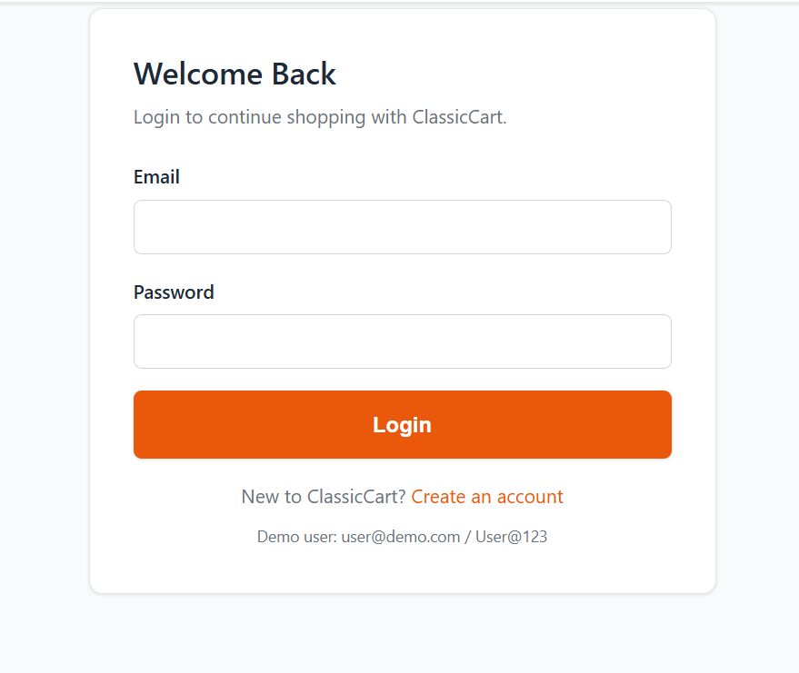
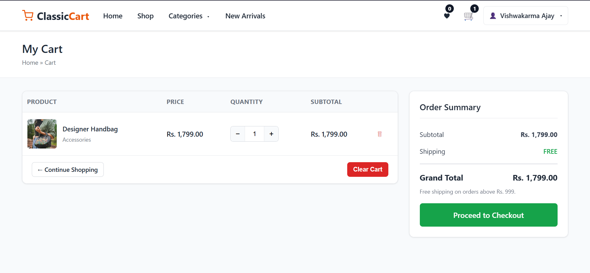
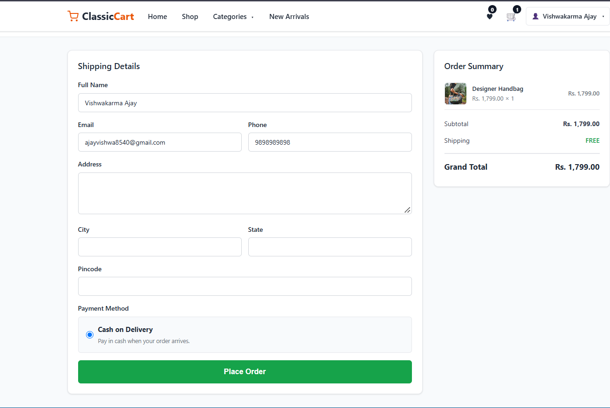
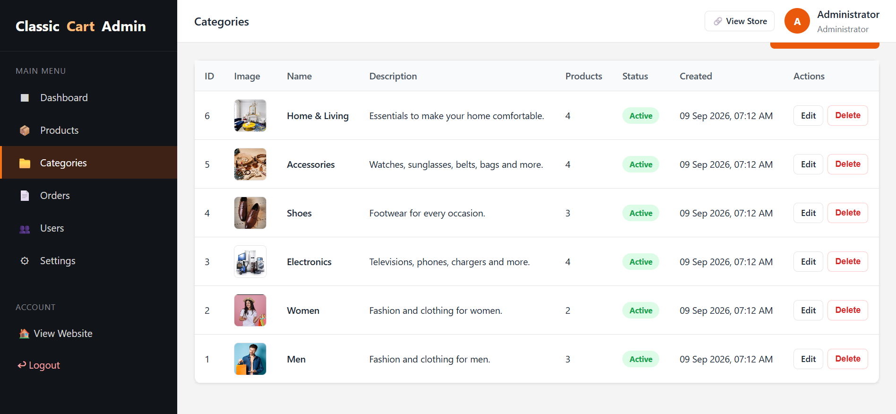
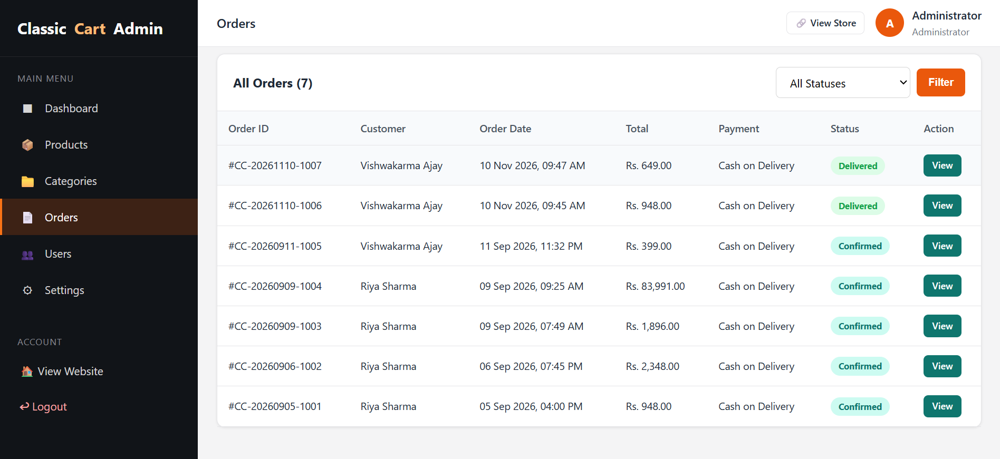

# ClassicCart – PHP E-Commerce Website

A complete, professional and fully functional e-commerce website built with **Core PHP**, **MySQL**, **jQuery** and **pure CSS** — perfect for a BCA / college project.

- **User Panel** – browse, search, filter, cart, wishlist, checkout (Cash on Delivery), orders, profile.
- **Admin Panel** – dashboard, product/category CRUD, user & order management.

---

## Features

| User Panel | Admin Panel |
|---|---|
| Register / Login / Logout | Secure admin login |
| Browse, search & filter products | Dashboard with live stats |
| Product details with rating & stock | Add / edit / delete products |
| Add to cart, update quantity, remove | Add / edit / delete categories |
| Wishlist + move wishlist item to cart | View & manage customers |
| Checkout (Cash on Delivery) | View orders & update order status |
| Order confirmation & order history | Change admin profile & password |
| View / update profile & password | Fixed responsive sidebar |

Security implemented: prepared SQL statements (PDO), `password_hash()` / `password_verify()`, PHP sessions, CSRF tokens, input validation, output escaping (htmlspecialchars), file upload type & size validation, admin authorization checks.

---

## Requirements

- [XAMPP](https://www.apachefriends.org/) (Apache, MySQL/MariaDB, PHP 7.4+)
- Any modern web browser
- phpMyAdmin (comes with XAMPP)

---

## Installation (Windows + XAMPP)

1. Install XAMPP and open the **XAMPP Control Panel**.
2. Click **Start** next to **Apache** and **Start** next to **MySQL**.
3. Copy this entire `ClassicCart` folder into your `htdocs` folder:
   ```
   C:\xampp\htdocs\ClassicCart\
   ```
4. Open phpMyAdmin: `http://localhost/phpmyadmin/`
5. Click **New** on the left and create a database named:
   ```
   classiccart
   ```
   (Choose `utf8mb4_general_ci` as collation.) Leave it empty.
6. Select the `classiccart` database, click the **Import** tab, choose the file:
   ```
   database/classiccart.sql
   ```
   then click **Go**. This creates all tables and sample data.
7. (Optional) Check the database credentials in:
   ```
   config/database.php
   ```
   Default XAMPP credentials are `root` with an empty password.
8. Open the website in your browser:
   ```
   http://localhost/ClassicCart/
   ```

## Admin Panel

Open the admin panel (you must be logged in to an admin):

```
http://localhost/ClassicCart/admin/
```

### Default Admin Account

| Field   | Value                  |
|---------|------------------------|
| Email   | `admin@classiccart.com`|
| Password| `Admin@123`            |

### Sample Customer Account

| Field   | Value                 |
|---------|-----------------------|
| Email   | `user@demo.com`       |
| Password| `User@123`            |

> The first thing you should do in a real deployment is change the default admin password
> from the **Settings** page.

---

## Sample Data Included

- 1 admin account
- 2 sample customer accounts
- 6 categories with images (Men, Women, Electronics, Shoes, Accessories, Home & Living)
- 20 sample products with images (generated placeholders in `uploads/products/`)
- Sample cart, wishlist, and 2 sample orders

---

## Project Structure

```
ClassicCart/
├── index.php               Home page
├── shop.php                Product listing with search/filter/sort/pagination
├── product.php             Product details
├── cart.php                Shopping cart (+ AJAX add/update/remove/clear)
├── wishlist.php            Wishlist (+ AJAX actions)
├── checkout.php            Checkout & order placement (COD)
├── order-success.php       Order confirmation
├── orders.php              My orders
├── order-details.php       Customer order details
├── login.php | register.php | logout.php
├── profile.php             Profile & password update
│
├── config/
│   └── database.php        PDO connection settings
├── includes/
│   ├── header.php          Shared <head>, navbar, flashes
│   ├── navbar.php          Responsive navigation
│   ├── footer.php          Footer + scripts
│   ├── auth.php            User/admin authentication guards
│   └── functions.php       Helpers, CSRF, cart totals, product cards, uploads
│
├── assets/
│   ├── css/style.css       Front-end styles (responsive)
│   ├── js/script.js        jQuery interactions
│   ├── vendor/jquery.min.js
│   └── images/             favicon
│
└── uploads/
    ├── products/       Uploaded + sample product images
    └── categories/     Uploaded + sample category images
│
├── admin/
│   ├── login.php | logout.php
│   ├── dashboard.php       Stats + recent orders
│   ├── products.php        product-add.php  product-edit.php  product-delete.php
│   ├── categories.php      category-add.php category-edit.php category-delete.php
│   ├── users.php           Customer management
│   ├── orders.php          order-details.php  order-status.php
│   ├── settings.php        Admin profile & password
│   ├── includes/           header.php  sidebar.php  footer.php
│   └── assets/             css/admin.css  js/admin.js
│
└── database/
    └── classiccart.sql     Complete database schema + sample data
```

---

## Important Notes

- Orders use **Cash on Delivery** only (no real payment gateway is integrated, as intended for a college project).
- Cart and wishlist require a logged-in user.
- The **Shipping** charge is a flat `Rs. 50`; shipping is **FREE** for orders above `Rs. 999`.
- Products with **zero stock** cannot be added to the cart or ordered.
- jQuery is bundled locally (`assets/vendor/jquery.min.js`) so the site works **without internet**.

---

## Troubleshooting

- **"Database connection could not be established"** – Make sure MySQL is started in the XAMPP control panel and the database `classiccart` has been imported.
- **Blank page** – Enable `display_errors` temporarily in `php.ini` to see the error, or check the Apache error log (`C:\xampp\apache\logs\error.log`).
- **Images not loading** – Make sure `uploads/products/` exists and is writable.
- **Admin redirects to login** – Log out and log in again; clear browser cookies if needed.


## 📸 Project Screenshots

### User Panel







### Admin Panel




